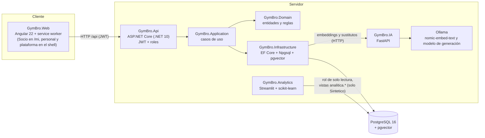
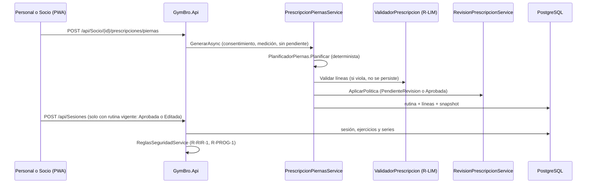
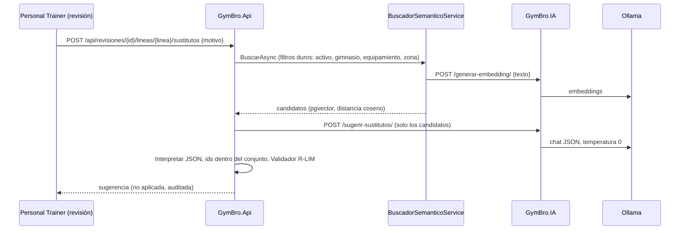
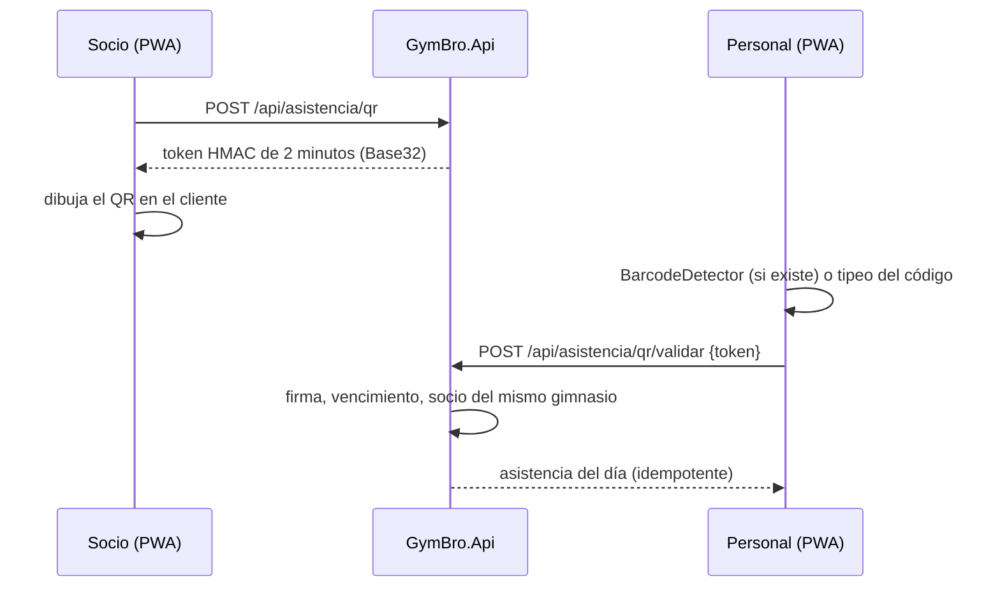

# Arquitectura de GymBro

> Documento generado desde el código de la rama **`cierre-pfc`** (Etapa 14). Solo describe lo verificado en el código; cada afirmación cita el archivo. Estado de cada funcionalidad: `estado-implementacion.md`.

## Vista general

## Capas (.NET)

| Proyecto | Responsabilidad | Ejemplos |
|---|---|---|
| `GymBro.Domain` | Entidades, enums, reglas puras e invariantes; interfaces de repositorio | `Entities/PrescripcionEntrenamiento.cs` (`EsVigente`, `Revisar`), `Rules/PlanificadorPiernas.cs`, `Rules/ValidadorPrescripcion.cs`, `Rules/Kpis/KpisProgresion.cs`, `Entities/CuotaSocio.cs` (`EstaVencida`) |
| `GymBro.Application` | Casos de uso y servicios de aplicación; DTOs | `Services/SesionEntrenamientoService.cs`, `PrescripcionPiernasService.cs`, `ReglasSeguridadService.cs`, `AsistenciaService.cs`, `CuotaService.cs`, `SugerenciaSustitutosService.cs`, `Sintetico/*` |
| `GymBro.Infrastructure` | Persistencia (EF Core, snake_case, pgvector), repositorios, clientes HTTP, generador sintético | `Persistence/GymBroDbContext.cs`, `Repositories/*`, `Services/BuscadorSemanticoService.cs`, `ExternalServices/IaService.cs`, `ExternalServices/GeneradorSustitutosIa.cs`, `Sintetico/GeneradorSintetico.cs` |
| `GymBro.Api` | Controladores, autenticación JWT, autorización por roles, manejo de errores, arranque | `Program.cs`, `Controllers/*`, `Security/HttpUsuarioActual.cs`, `Infrastructure/ManejadorExcepciones.cs` |

Otros componentes: `GymBro.Web` (Angular, `src/app/features/*`, `core/*`), `GymBro.IA` (`main.py`, `sustitutos.py`, `evaluacion/*`), `GymBro.Analytics` (`gymbro_analytics/*`, `app/principal.py`, `entrenar_abandono.py`, `puntuar_abandono.py`). Pruebas: `GymBro.Tests` (unitarias) y `GymBro.Tests.Integration` (API real contra PostgreSQL descartable con Testcontainers, `GymBroApiFactory.cs`).

## Seguridad y aislamiento

- **Autenticación:** JWT HS256 con claims `sub`, `role`, `gimnasio_id`, `socio_id` (`Security/GeneradorTokenJwt.cs`); política por defecto que exige usuario autenticado (`Program.cs`, `FallbackPolicy`).
- **Roles:** `SuperAdministrador`, `AdministradorGimnasio`, `Entrenador`, `Socio` (`Domain/Enums/RolUsuario.cs`), aplicados con `[Authorize(Roles = …)]` en cada controlador.
- **Multigimnasio:** filtros globales de consulta en `GymBroDbContext.cs` según `IUsuarioActual` (gimnasio del JWT para el personal, ficha propia para el Socio). Un recurso no visible responde 404 (`SocioAccessService`, `GimnasioDestino`).
- **Ley 25.326:** el Administrador de la Plataforma no entra en los filtros de socios, mediciones, sesiones, prescripciones, bienestar ni alertas, y `SocioAccessService` le responde 403; sí lee lo que no es dato de salud (gimnasios, catálogo, equipamiento, asistencia y cuotas). Verificado en `MatrizAutorizacionTests.cs`.
- **Analítica:** solo vistas `analitica.*` que exponen datos `Sintetico`, con roles propios (`docs/pfc/scripts/rol-analitica.sql`).

## Flujos principales

### Rutina de piernas y sesión

### Búsqueda semántica y sustitutos

### Asistencia con QR

## Despliegue

`docker-compose.full.yml` y `docs/despliegue.md` (Etapa 13); integración continua en `.github/workflows/ci.yml` (sin despliegue).
