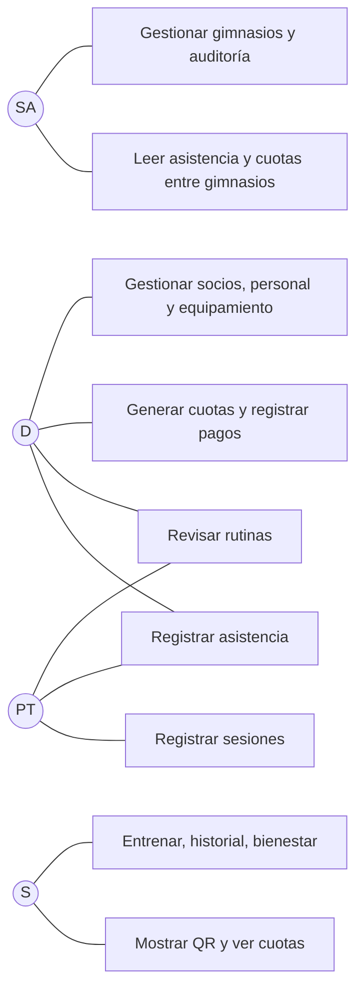

# Casos de uso de GymBro

> Generado desde los controladores de la rama **`cierre-pfc`** (`GymBro.Api/Controllers`) y las rutas del cliente (`GymBro.Web/src/app/app.routes.ts`). Para cada caso: actor, endpoint y regla de acceso verificada en el código y en `GymBro.Tests.Integration/MatrizAutorizacionTests.cs`.

Actores: **SA** Administrador de la Plataforma (`SuperAdministrador`), **D** Dueño de Gimnasio (`AdministradorGimnasio`), **PT** Personal Trainer (`Entrenador`), **S** Socio.

## Acceso, gimnasios y personal

| Caso | Actores | Endpoint | Notas |
|---|---|---|---|
| Iniciar sesión, registrarse como socio, activar invitación | todos | `POST /api/auth/login`, `registro-socio`, `invitacion/consultar`, `invitacion/activar` | anónimos; límite de intentos (`RateLimiter`) |
| Gestionar gimnasios | SA | `GET/POST /api/gimnasios`, `PUT /api/gimnasios/{id}/estado` | |
| Política de revisión del gimnasio | D, SA (indicando gimnasio) | `GET /api/mi-gimnasio`, `PUT /api/mi-gimnasio/politica-revision` | |
| Personal Trainers y asignaciones | D | `/api/personal/entrenadores`, `/api/personal/entrenadores/{id}/socios` | |
| Vincular socio a gimnasio | S (solicita); D o SA (resuelve) | `POST /api/vinculaciones`, `GET mias`, `GET pendientes`, `POST {id}/resolver` | |
| Auditoría | SA | `GET /api/auditoria` | |

## Socios, salud y entrenamiento

| Caso | Actores | Endpoint | Notas |
|---|---|---|---|
| Consultar y gestionar socios | D (alta, edición, baja, estado, invitación); PT (asignados); S (propio) | `/api/Socio`, `/api/Socio/{id}`, `/estado`, `/invitacion` | SA 403: datos de salud |
| Mediciones físicas | D, PT, S | `GET/POST /api/Medicion` | |
| Limitaciones articulares | D, PT, S | `GET/PUT /api/Socio/{id}/limitaciones-articulares` | exige consentimiento |
| Generar rutina baseline o de piernas | D, PT, S | `POST /api/Socio/{id}/prescripciones/baseline` y `/piernas` | política de revisión del gimnasio |
| Revisar rutina | D, PT asignado | `GET /api/revisiones/pendientes`, `POST /api/revisiones/{id}` | decisión Aprobada, Editada o Rechazada |
| Sugerir sustitutos de una línea | D, PT asignado | `POST /api/revisiones/{id}/lineas/{linea}/sustitutos` | sugerencia no aplicada; no en el protocolo de piernas |
| Registrar sesión y ver comparación | D, PT, S | `POST /api/Sesiones`, `GET /api/Sesiones/{id}`, `/comparacion`, `GET /api/Sesiones?socioId=` | solo con rutina vigente |
| Bienestar diario | S (carga hoy o ayer); D, PT, S (historial) | `GET /api/bienestar/hoy`, `PUT /api/bienestar/{fecha}`, `GET /api/bienestar` | |
| Alertas de seguridad | D, PT, S | `GET /api/alertas`, `PUT /api/alertas/{id}/vista` | |
| KPIs de progresión | D, PT, S | `GET /api/Socio/{id}/kpis-progresion` | solo socios `Sintetico` (salvo pedido explícito de validación funcional) |

## Catálogo

| Caso | Actores | Endpoint |
|---|---|---|
| Consultar catálogo y zonas | todos los autenticados | `GET /api/Ejercicios`, `/{id}`, `/zonas` |
| Ejercicios propios (crear, editar, activar o desactivar) | D, PT (propone), SA (indicando gimnasio) | `POST /api/Ejercicios`, `PUT /{id}`, `PUT /{id}/estado` |
| Búsqueda semántica | todos los autenticados | `POST /api/Ejercicios/busqueda-inteligente` (y `GET` anterior) |
| Equipamiento del gimnasio | D, SA (escritura); PT (lectura) | `/api/equipamiento`, `/previsualizacion`, `/tipos` |

## Asistencia y cuotas (Etapa 11)

| Caso | Actores | Endpoint |
|---|---|---|
| Obtener el QR | S | `POST /api/asistencia/qr` |
| Registrar asistencia por QR o código | D, PT | `POST /api/asistencia/qr/validar` |
| Registrar asistencia manual | D, PT | `POST /api/asistencia/manual` |
| Ver la asistencia del día | D, PT (propio gimnasio); SA (todos, solo lectura) | `GET /api/asistencia` |
| Generar cuotas y registrar pagos | D | `POST /api/cuotas/generar`, `PUT /api/cuotas/{id}/pago` |
| Cuotas del mes y morosos | D; SA (solo lectura) | `GET /api/cuotas`, `GET /api/cuotas/morosos` |
| Mis cuotas | S | `GET /api/cuotas/mias` |

## Fuera de la API

| Caso | Actor | Componente |
|---|---|---|
| Generar o eliminar datos sintéticos | desarrollador (solo `Development`) | `dotnet run --project GymBro.Api -- --generar-sintetico` / `--eliminar-sintetico` |
| Entrenar y puntuar el modelo de abandono | autores | `GymBro.Analytics/entrenar_abandono.py`, `puntuar_abandono.py` |
| Analizar datos y tableros | autores (usuario de configuración) | `GymBro.Analytics/app/principal.py` |
| Evaluar la recuperación y medir sustitutos | autores | `GymBro.IA/evaluacion/*.py` |
