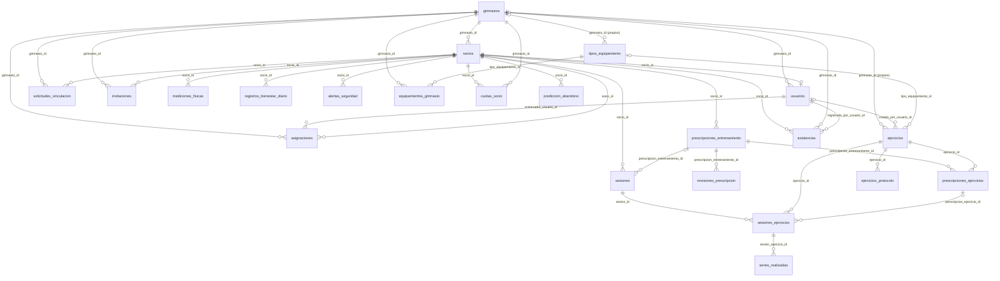

# Modelo de datos de GymBro

> Generado desde las migraciones de EF Core de la rama **`cierre-pfc`** (`GymBro.Infrastructure/Migrations/GymBroDbContextModelSnapshot.cs`, última migración `20261125215213_Etapa10b1_PrediccionAbandono`) y la configuración de `GymBro.Infrastructure/Persistence/GymBroDbContext.cs`. PostgreSQL 16 con la extensión `vector`; nombres en snake_case.

## Diagrama entidad-relación

Relaciones tomadas de las claves foráneas del snapshot. Todas las tablas heredan las columnas de auditoría de `EntidadAuditable` (`fecha_alta`, `usuario_alta`, `fecha_modificacion`, `usuario_modificacion`, `fecha_baja`, `usuario_baja`), salvo `audit_logs` y `revisiones_prescripcion`; se omiten en el diagrama.

Tablas sin claves foráneas: `matrices_recomendacion`, `dosificaciones` (catálogos del baseline) y `audit_logs` (solo agregado; guarda `usuario_id` y `gimnasio_id` sin clave foránea).

## Restricciones relevantes

| Tabla | Restricción | Definida en |
|---|---|---|
| `socios` | CHECK de `nivel`, `objetivo`, `estado`, `limitacion_rodilla`, `limitacion_lumbar`, `origen_datos`; `dni` único | `GymBroDbContext.cs` (`CK_Socio_*`, índice de `dni`) |
| `usuarios` | `CK_Usuario_Rol_Alcance` (rol frente a gimnasio y ficha); email único | `GymBroDbContext.ConfigurarAccesoYTenants` |
| `prescripciones_ejercicios` | series > 0, repeticiones mínimas > 0 y máximas ≥ mínimas, RIR 0 a 5, descanso > 0, orden único por rutina | `GymBroDbContext.cs` (`CK_PrescripcionEjercicio_*`) |
| `series_realizadas` | repeticiones > 0, peso ≥ 0, RIR 0 a 5 | `GymBroDbContext.cs` (`CK_SerieRealizada_*`) |
| `registros_bienestar_diario` | rangos de sueño, estrés, fatiga, peso, agua, FC de reposo (30 a 120); único por socio y fecha vigente | `GymBroDbContext.ConfigurarBienestarDiario` |
| `alertas_seguridad` | CHECK de regla, tipo, severidad y estado; único por socio, regla y origen | `GymBroDbContext.ConfigurarAlertasSeguridad` |
| `ejercicios` | `CK_Ejercicio_OrigenGimnasio`, tipo de medida, embedding `vector(768)` | `GymBroDbContext.cs` (`CK_Ejercicio_*`, `HasColumnType("vector(768)")`) |
| `asistencias` | método `Qr` o `Manual`; **único por socio y fecha** (filas vigentes) | `Etapa11_AsistenciaYCuotas` |
| `cuotas_socio` | estado `Pendiente` o `Pagada`; `CK_CuotaSocio_Pago` (pagada si y solo si tiene fecha de pago); período y monto; **único por socio, año y mes** | `Etapa11_AsistenciaYCuotas` |
| `prediccion_abandono` | puntaje 0 a 1; único por socio, fecha y versión del modelo | `Etapa10b1_PrediccionAbandono` |

## Migraciones

`EstandarizacionAuditoriaYSnakeCase`, `ConsolidacionFinalDominio`, `ConsolidacionFinalV2Dominio`, `ConfiguracionVectorialesIA`, `ConfiguracionVectorialesIA_V2`, `AddPrescripcionEntrenamiento`, `Fase1_5_EjecucionYTelemetria`, `AccesoYTenants`, `Etapa6_InvitacionesSocio`, `Etapa8b_BienestarDiario`, `Fix_EnumsNoDefinidos`, `Etapa9a1_CatalogoCore`, `Etapa9a2_CatalogoGimnasio`, `Etapa9a2b_AdminCatalogo`, `Etapa10a_ReglasSeguridad`, `Etapa7d_ProtocoloPiernas`, `Etapa11_AsistenciaYCuotas`, `Etapa10b1_PrediccionAbandono` (18; verificado al aplicarlas sobre una base vacía, `etapa10b1-ejecucion.txt`).

## Esquema `analitica`

Creado por `docs/pfc/scripts/rol-analitica.sql` (no por las migraciones): vistas `v_socios`, `v_gimnasios`, `v_asistencias`, `v_cuotas`, `v_bienestar`, `v_series` y `v_prediccion_abandono`, solo con socios `Sintetico`, y los roles `gymbro_analitica_lectura` y `gymbro_analitica_puntuacion`.
