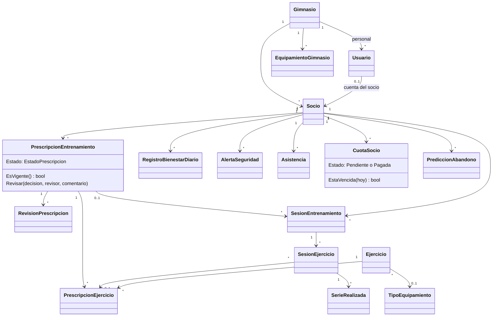

# Modelo de dominio de GymBro

> Generado desde el código de la rama **`cierre-pfc`** (`GymBro.Domain/Entities`, `GymBro.Domain/Enums`, `GymBro.Domain/Rules`). Solo lo verificado en el código.

## Conceptos y reglas

| Concepto | Entidad (archivo) | Reglas e invariantes verificadas |
|---|---|---|
| Gimnasio (tenant) | `Gimnasio.cs` | Código único; `RequiereAprobacionRutinas` define si una rutina generada queda `PendienteRevision` o `Aprobada` (`PrescripcionEntrenamiento.DefinirEstadoInicial`) |
| Usuario y rol | `Usuario.cs`, `Enums/RolUsuario.cs` | Roles `SuperAdministrador`, `AdministradorGimnasio`, `Entrenador`, `Socio`; CHECK `CK_Usuario_Rol_Alcance`: el personal tiene gimnasio, el socio tiene ficha, la plataforma no tiene ninguno |
| Socio | `Socio.cs` | Un único `GimnasioId` (o independiente); estado administrativo informativo (`EstadoSocio`); consentimiento de datos de salud; limitaciones articulares (dato de salud); `OrigenDatos` (`Sintetico`, `ValidacionFuncional`, `DatasetExterno`, `Real`) |
| Vínculo socio-gimnasio | `SolicitudVinculacion.cs`, `InvitacionSocio.cs` | Una solicitud pendiente por socio y gimnasio; invitación de un solo uso con token guardado como hash |
| Asignación Personal Trainer – socio | `AsignacionEntrenadorSocio.cs` | Única por entrenador y socio; el trainer solo accede a sus asignados (`SocioAccessService`) |
| Prescripción (rutina) | `PrescripcionEntrenamiento.cs`, `PrescripcionEjercicio.cs` | Distinta de la sesión ejecutada; estados `Creada`, `Aceptada`, `Cancelada`, `PendienteRevision`, `Aprobada`, `Editada`, `Rechazada` (texto); **vigente = `Aprobada` o `Editada`** (`EsVigente`); solo se revisa si está `PendienteRevision` (`Revisar`); RIR objetivo 0 a 5 (CHECK) |
| Revisión humana | `RevisionPrescripcion.cs` | Decisión `Aprobada`, `Editada` o `Rechazada` (con motivo); violaciones R-LIM registradas |
| Sesión ejecutada | `SesionEntrenamiento.cs`, `SesionEjercicio.cs`, `SerieRealizada.cs` | Solo con prescripción vigente del mismo socio (`SesionEntrenamientoService.RegistrarSesionAsync`); vínculo opcional a la línea prescrita; series con RIR 0 a 5 y calentamiento separado |
| Indicador de esfuerzo | `SerieRealizada.RIR`, `PrescripcionEjercicio.RIRObjetivo` | **RIR** (no RPE) |
| Bienestar diario | `RegistroBienestarDiario.cs` | Uno por socio y día local (`DiaLocal`, America/Argentina/Buenos_Aires); FC **de reposo**; rangos en `RangosBienestar` y CHECK |
| Alerta de seguridad | `AlertaSeguridad.cs`, `Rules/ReglasSeguridad.cs` | Reglas R-RIR-1, R-PROG-1, R-FC-1 (umbrales en `ReglasSeguridadConfig`); una fila por socio, regla y origen |
| Límites de prescripción | `Rules/ValidadorPrescripcion.cs` | R-LIM: series, repeticiones o segundos, descanso, RIR (mínimo para principiantes), cantidad de ejercicios, series totales, ejercicio repetido |
| Protocolo de piernas | `EjercicioProtocolo.cs`, `Rules/PlanificadorPiernas.cs`, `ProtocoloPiernasConfig.cs` | Generación determinista (`piernas-1.0`) con rotación, exclusiones por limitación y reducción por alerta |
| Catálogo y equipamiento | `Ejercicio.cs`, `TipoEquipamiento.cs`, `EquipamientoGimnasio.cs` | Ejercicios globales o propios de un gimnasio; activos o desactivados; tipo de medida `Repeticiones` o `Segundos`; embedding de 768 dimensiones |
| KPIs del estudio | `Rules/Kpis/KpisProgresion.cs` | K1 (delta de carga máxima), K2 (volumen efectivo), K3 (adherencia al rango y desvío de RIR), K4 (índice de seguridad); descriptivos; solo socios `Sintetico` |
| Asistencia | `Asistencia.cs` | Una por socio y día local (índice único); método `Qr` o `Manual`; registrada por el personal |
| Cuota | `CuotaSocio.cs` | Una por socio y período; estado `Pendiente` o `Pagada` (con fecha de pago, CHECK); **vencida se deriva** (`EstaVencida`) |
| Puntaje de abandono | `PrediccionAbandono.cs` | Puntaje 0 a 1 por socio, fecha y versión; lo escribe `GymBro.Analytics` |
| Auditoría | `AuditLog.cs` | Solo agregado; sin datos de salud en el detalle |

## Diagrama de clases (resumen)

